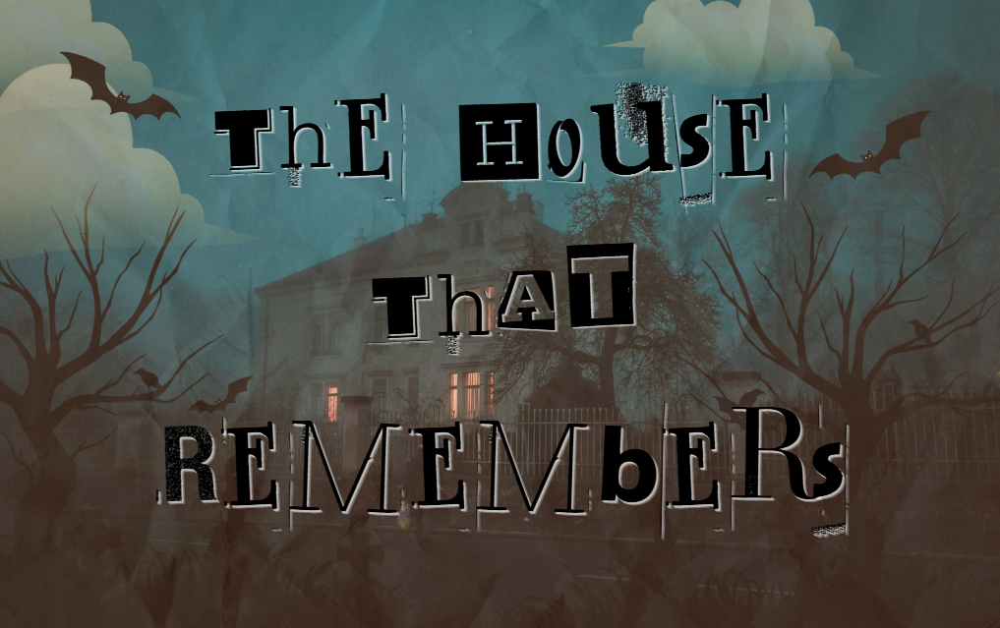
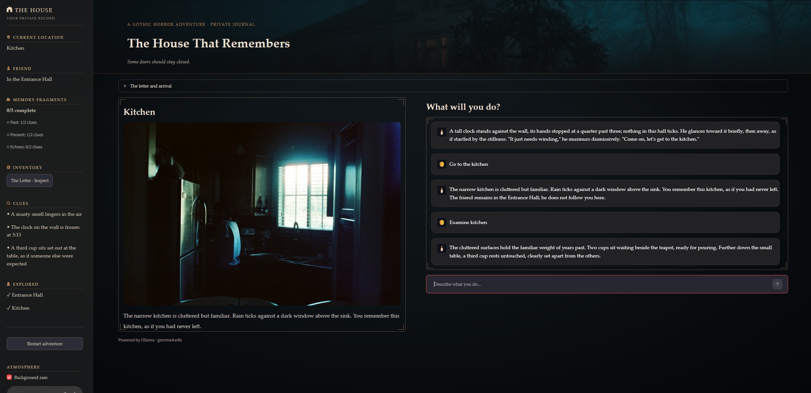

# Hacktoberfest Open-Source AI - Week 4



## The House That Remembers

This is my submission for the Hacktoberfest Open-Source AI Challenge: Week 4. This week's theme is "Ghost in the Machine": build something spooky, or something that honors the past in the spirit of Día de los Muertos, using open-weight models or open-source AI.

Because I love the spooky season, D&D, and reading crazy thrillers 😅, I decided to build a short D&D-style game. I call it _The House That Remembers_, and it's inspired by Edgar Allan Poe's 1839 story _The Fall of the House of Usher_. The `story` folder contains major spoilers, so if you want to enjoy the game, I recommend avoiding those files.

Tech stack:
- Streamlit (`app.py`) - UI and chat interface
- Python - game logic, action validation, and history, clue, and inventory tracking
- Ollama + Gemma - narrate the permitted outcome

Trigger warning: This is a horror story. It contains no gore, but it does mention death and related themes.

### Premise
_The letter arrived three nights ago, its paper creased and stained, the handwriting unmistakably your friend's — though the words were unlike anything you had ever known him to write._

_"Please, you must come. There are things in this house I can no longer explain. I'm afraid it may be too late for me. You're the only person I can trust."_

_Now, you stand before his home. Rain lashes against your face, and thunder rolls across the darkened sky. The house looms above you, its crooked silhouette barely visible through the mist. Tall, narrow windows stare down like hollow eyes. Ivy claws at the weathered stone walls, and the iron gates behind you groan in the wind, slowly swinging shut._

_You remember this house from your childhood, but something about it feels wrong. You used to play outside, spend time helping your friend with chores in the kitchen, explore the family library, and even sleep over in the guest room._

_The air is unnaturally cold, carrying the scent of wet earth and rotting leaves. Though no lights burn inside, you cannot shake the feeling that someone is watching you from the upper windows._

_For a moment, lightning illuminates the facade — and you could swear a shadow has just moved behind the glass._

_Then the thunder cracks._

_The front door stands slightly ajar._

_Your friend invited you here for help. But as you stare into the darkness beyond the threshold, a troubling thought creeps into your mind:_

_Did he invite you into the house… or did the house invite you in?_



### Tips for interacting with the story

Describe your actions—lots of things are possible! Think about your goal and what you hope to achieve. There is no right or wrong way to play this game. It's based on TTRPG-style games, where you role-play a character. The model serves as the DM (Dungeon Master), or narrator. It tells the story, acts as the referee, maintains the setting, and plays the NPCs (non-player characters).

The narrator distinguishes spoken dialogue, physical actions, exploration, and
questions about the player's memories. You can make the intent clear in natural
language:

- Speak to your friend: `What can I do for you?` or `I say, "Let's go."`
- Combine speech and an action: `I pat him on the back and say, "Let's go."`
- Explore or examine: `Look around` or `Examine the family photos.`
- Recall an established memory: `What do I remember about my friend?`
- Move directly to a destination, even when it is several rooms away: `I go to the upper landing.`
- Examine a book or note to read it and add it to your inventory; no separate pickup command is needed.

The sidebar tracks the Past, Present, and Echoes fragments needed to finish the story. Two clues in each category complete a fragment; the house also holds
atmospheric and optional lore discoveries that do not count toward fragment
progress.

### Run the Streamlit app locally

By default, the app uses Ollama locally. Install Ollama and download the model:

```powershell
ollama pull gemma4:e4b
```

Make sure the Ollama service is running. Then, from the repository root, install the project dependencies. You can optionally create and activate a virtual environment first:

```powershell
py -m venv .venv
.\.venv\Scripts\Activate.ps1
python -m pip install -r requirements.txt
```

Start the app with:

```powershell
python -m streamlit run .\the-house-that-remembers\app.py
```

Streamlit prints a local URL in the terminal; open it in your browser to view the app. After the initial download, it can run on your machine offline.

### Play online

Deployed on Render: [https://the-house-that-remembers.onrender.com/](https://the-house-that-remembers.onrender.com/)

I'm using the provided free credits and will keep it running until the end of Hacktoberfest (or until I run out). LLM responses are a little slow: the first load might be especially slow, and subsequent responses take around 24 seconds. Render doesn't provide GPU compute on this plan, so the model runs on CPUs.